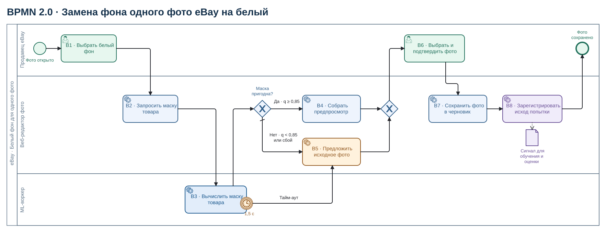

# eBay · белый фон для одного фото товара

Учебная реконструкция ML-процесса в веб-редакторе объявления eBay. Продавец открывает уже загруженное фото и выбирает замену фона на белый. Процесс завершается, когда в черновике сохранена выбранная версия фото и редактор подтверждает сохранение.

## Границы процесса

В работе рассматривается одна попытка обработки одного фото. Сюда входят выделение товара, выбор между предпросмотром и исходником, сохранение выбора в черновике и обратная связь для следующей версии модели. Загрузка исходника, публикация объявления, генерация новых сцен, ручная ретушь и обработка ошибок сохранения находятся за рамками.

Модель решает задачу пиксельного выделения товара. На вход подаётся RGB-тензор, полученный из исходного фото. На выходе — карта вероятности принадлежности пикселей товару. ML-воркер возвращает редактору альфа-маску, оценку качества маски `q` и версию модели либо статус сбоя. Редактор применяет маску для предпросмотра, а окончательный выбор делает продавец. Бизнес-цель — сократить ручную обработку и сохранить видимые детали товара.

## Как читать схемы

| Схема | Исходник | Изображение |
|---|---|---|
| BPMN 2.0 · замена фона | [bpmn.bpmn](diagrams/bpmn.bpmn) · Camunda Modeler или bpmn.io | [bpmn.svg](diagrams/bpmn.svg) |
| C4 L1 · контекст | [c4-context.mmd](diagrams/c4-context.mmd) · Mermaid Live Editor | [c4-context.svg](diagrams/c4-context.svg) |
| C4 L2 · контейнеры | [c4-containers.mmd](diagrams/c4-containers.mmd) · Mermaid Live Editor | [c4-containers.svg](diagrams/c4-containers.svg) |
| C4 L3 · ML-воркер | [c4-components.mmd](diagrams/c4-components.mmd) · Mermaid Live Editor | [c4-components.svg](diagrams/c4-components.svg) |

SVG открываются в браузере и увеличиваются без потери чёткости. Для редактирования BPMN откройте файл командой **File → Open** в Camunda Modeler или перетащите его в [bpmn.io](https://demo.bpmn.io/). Для редактирования C4 вставьте содержимое файла `.mmd` в [Mermaid Live Editor](https://mermaid.live/). На C4 серый цвет обозначает внешнюю систему, синяя рамка задаёт границу рассматриваемой системы или контейнера, а пунктирная рамка на C4 L3 отмечает вход или выход ML-воркера. На BPMN круги обозначают события, ромбы с крестом — исключающие шлюзы, а пунктир к объекту данных — передачу данных.

Маршруты того же процесса доступны в [исходнике Mermaid](diagrams/bpmn.mmd) и [его изображении](diagrams/bpmn-mermaid.svg). Дорожки и семантика граничного события хранятся в BPMN 2.0.

## Проход по BPMN

| Ситуация | Что увидит продавец | Что попадёт в сигнал |
|---|---|---|
| Маска получена, `q ≥ 0,85` | Предпросмотр на белом фоне и возможность оставить исходник | `accepted` или `kept_original`, версия модели, `q` |
| Маска получена, `q < 0,85` | Исходное фото, которое можно подтвердить | `fallback_low_q`, версия модели, `q` |
| Воркер недоступен, завершился с ошибкой или истекло время ожидания | Исходное фото, которое можно подтвердить | `fallback_unavailable`, код причины, версия при наличии |

## Допущения

1. **Развёртывание.** Веб-редактор запускает отдельно публикуемый ML-воркер в браузере. Редактор получает исходник из сервиса черновиков и записывает туда выбранную версию. ML-воркер работает с пикселями локально. Реестр публикует манифест и версионированные веса. Воркер использует последнюю успешно проверенную локальную версию, если манифест недоступен. Если совместимой версии нет, возвращается статус сбоя.
2. **Модель.** Для реконструкции выбрана модель сегментации в формате ONNX, запускаемая через ONNX Runtime Web. Подготовка признаков декодирует фото, учитывает ориентацию, масштабирует с полями до 512 × 512 и нормализует RGB. После инференса воркер снимает поля, восстанавливает геометрию маски и вычисляет `q` по статистикам карты вероятностей. На размеченной выборке `q` калибруется как оценка вероятности того, что IoU бинаризованной маски товара с эталоном не ниже 0,90.
3. **Правило показа.** Порог `0,85` и лимит ожидания `1,5 с` заданы для учебного сценария. Таймер редактора идёт с момента отправки запроса воркеру. По истечении лимита редактор формирует статус недоступности и игнорирует поздний ответ по идентификатору попытки. При `q ≥ 0,85` редактор смешивает исходные пиксели с белым цветом по альфа-маске. При низкой оценке или сбое предпросмотр с белым фоном пропускается. Оба пути заканчиваются подтверждением фото продавцом.
4. **Сигнал после сохранения.** Редактор регистрирует событие с идентификатором попытки, ссылкой на исходник, исходом, версией и доступными диагностическими полями. Платформа событий дедуплицирует повторные доставки по идентификатору попытки. При временном сбое отправки редактор ставит событие в локальный буфер повторной отправки. Подтверждение сохранённого фото не ждёт аналитики.
5. **Оценка и следующее обучение.** Выбор продавца используется как поведенческий сигнал. Пайплайн передаёт в систему разметки ссылки из событий на выборку принятых, отклонённых и низко оценённых примеров. Система разметки загружает фото с разрешённым доступом из сервиса черновиков и возвращает пары «исходное фото + эталонная маска». Доля недоступности считается отдельно по событиям. Пайплайн разделяет данные по объявлениям между обучением, калибровкой и отложенной проверкой. На отложенной части он сравнивает средний IoU и долю плохих масок среди предложенных предпросмотров, после чего публикует прошедшую проверку версию и её калибровку.

## Соответствие BPMN и C4

| Задача BPMN | Контейнер или участник C4 | Что передаётся |
|---|---|---|
| B1 · Выбрать белый фон | Продавец → Веб-редактор фото | Действие для открытого фото |
| B2 · Запросить маску товара | Веб-редактор фото → ML-воркер | Исходные байты и идентификатор попытки |
| **B3 · Вычислить маску товара** | **ML-воркер** | RGB-тензор → маска, `q`, версия либо ошибка |
| B4 · Собрать предпросмотр | Веб-редактор фото | Исходные пиксели, альфа-маска и белый фон |
| B5 · Предложить исходное фото | Веб-редактор фото | Исходное фото и статус обработки |
| B6 · Выбрать и подтвердить фото | Продавец → Веб-редактор фото | Выбор показанной версии |
| B7 · Сохранить фото в черновик | Веб-редактор фото → Сервис черновиков | Выбранная версия фото |
| B8 · Зарегистрировать исход попытки | Веб-редактор фото → Платформа событий | Сигнал о сохранённом результате для офлайн-пайплайна |

На C4 L3 показано устройство ML-воркера для B3. Подписанные входы и выходы на его границе связывают вызов B2, проверку пригодности маски в редакторе и сборку предпросмотра B4.

## Источники

- Справка eBay описывает выбор фотографии, замену фона на белый в веб-редакторе и сохранение. [Adding pictures to your listings](https://www.ebay.com/help/selling/listings/adding-pictures-listing?id=4148)
- Публикация eBay о запуске Image Clean-up на десктопе описывает вычисление на устройстве пользователя. [eBay Introduces Its New Seamless Unified Listing Experience](https://innovation.ebayinc.com/stories/ebay-introduces-its-new-seamless-unified-listing-experience/)
- Публикация eBay о ранней версии Image Clean-up описывает компьютерное зрение, пиксельную маску и оценку пригодности результата. [eBay Uses Computer Vision to Enable Sellers to Create Cleaner Images](https://innovation.ebayinc.com/stories/ebay-uses-computer-vision-to-enable-sellers-to-create-cleaner-images/)
- Для нотаций использованы [примеры BPMN от Camunda](https://camunda.com/bpmn/examples/) и [описание уровней C4](https://c4model.com/).

Авторская часть работы — границы системы, три уровня C4, BPMN с развилками, состав компонентов, технологии и контракты между ними. Порог, тайм-аут, запасной путь, признаки, калибровка и контур обратной связи — проектные допущения для этого сценария.
